## Sobre mim

Faço o **Curso Técnico de Informática** no **Vasco Coutinho** e, ao mesmo tempo, **Sistemas de Informação na FAESA**. Quero atuar na área de TI e estou em busca de uma oportunidade de estágio.

## Linguagens de Programação

## Ferramentas

&nbsp;

## Atividade

## Contato

🏴‍☠️ **Zarpando rumo ao primeiro estágio em TI** 👒

